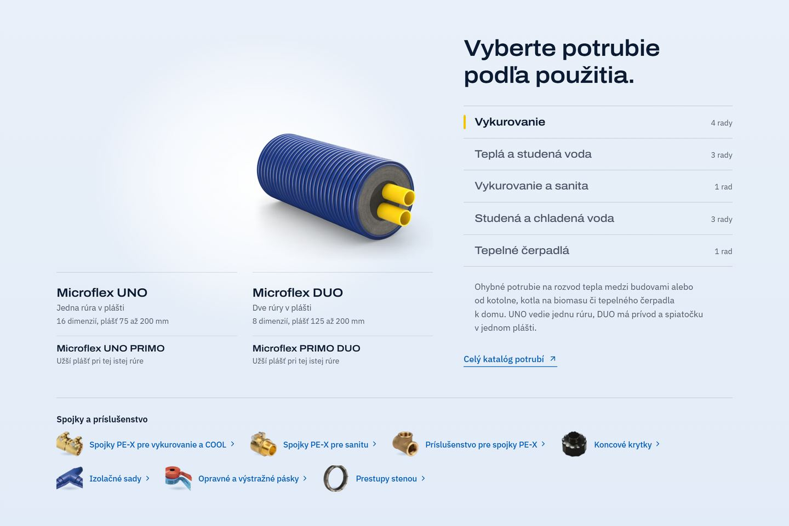

# Katalóg na domove so záložkami (22. 9. až 5. 11. 2026)



Sekcia „Vyberte potrubie podľa použitia.“ podľa Jurajovho vlastného návrhu z 22. 9. 2026, prekomponovaná 23. 9.
Vpravo bol **register** použití ako palcový register tlačeného katalógu: názov, počet radov a žltá značka pri
vybranom. Vľavo bolo **štúdio**, kde rendery radov vybraného použitia stáli na spoločnej podlahe. Vyhotovenia PRIMO
mali pod renderom základného radu vlastný riadok „Užší plášť pri tej istej rúre“ a dole bol riadok skupín spojok
a príslušenstva s malými fotkami. Záložky boli prepínače bez skriptu (radio a `:has()`) a obsah všetkých panelov
bol v HTML. Telefón mal posuvný pás radov s bodkami polohy a diely ako dva vstupy.

**Prečo preč:** bez kliknutia bolo vidieť 4 z 12 radov a register nevyzeral ako niečo, na čo sa dá kliknúť.
Mal aj veľa vlasových čiar. 5. 11. 2026 ho nahradila mriežka G2 (dlaždice podľa použitia), návrhy sú v
[../navrhy-katalogu-2026-11-05](../navrhy-katalogu-2026-11-05/).

**Súbory:** `Katalog.astro` je komponent presne z commitu `c497a27` (posledný stav pred G2). Telefón:
[katalog-telefon.jpg](katalog-telefon.jpg).

**Obnovenie:** skopírovať `Katalog.astro` do `web/src/components/` a do `web/src/i18n/ui.ts` do `home` vrátiť dva
texty, ktoré G2 nepotrebuje:

```ts
// sk
zobrazitRad: (nazov: string) => `Zobraziť ${nazov}`,
dielyH3: 'Spojky a príslušenstvo',
// cs
zobrazitRad: (nazov: string) => `Zobrazit ${nazov}`,
dielyH3: 'Spojky a příslušenství',
```

Starý komponent ráta s 200 px spodným okrajom pásu pre render rodiny (rodina je v
[../2026-11-06-domov-rodina](../2026-11-06-domov-rodina/)).
