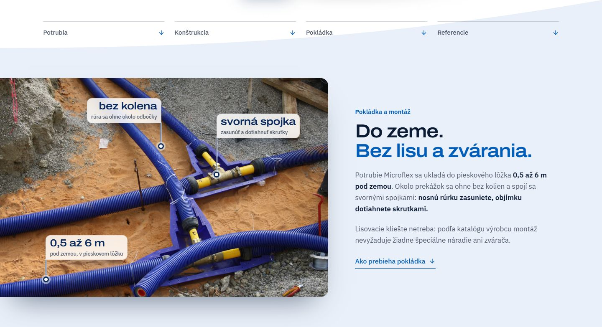

# Pás „Do zeme. Bez lisu a zvárania.“ pod úvodom (4. 11. až 6. 11. 2026)



Juraj ho 4. 11. 2026 vybral (variant B) a dal hneď pod úvod, aby bolo jasné, kam potrubie patrí a ako
jednoducho sa spája. Fotka výkopu so svornými spojkami vľavo cez okraj obrazovky, s kótami (svorná spojka,
bez kolena, 0,5 až 6 m), vpravo nadnadpis „Pokládka a montáž“, nadpis, dva odseky a odkaz „Ako prebieha
pokládka“. Pás prevzal od katalógu šikmú hranu pod úvodom. Telefón: [do-zeme-telefon.jpg](do-zeme-telefon.jpg).

**Prečo preč ako samostatný pás:** audit domova 6. 11. 2026 (`docs/AUDIT-DOMOV-2026-11-06.md`). Pás bol
kapitolou pokládky postavenou pred katalógom a jeho odkaz viedol o šesť obrazoviek nižšie. Tvrdenie
„bez zvárania“ bolo na domove trikrát. Juraj odsúhlasil 6. 11.

**Kam prešiel obsah (nič sa nestratilo):**
- správa: druhá veta v úvode („Ukladá sa priamo do zeme a spája sa bez lisu a zvárania.“, `home.lead`),
- fotka s kótami, nadpis a oba odseky: blok `.pk-zem` v sekcii Pokládka, pri ňom až 60 t a zdroje.

**Súbory:** `DoZemeDomov.astro` je pás ako samostatný komponent: označenie, dáta kót a štýly presne z
`web/src/templates/Domov.astro` (commit `43fdc71`).

**Obnovenie:**
1. Skopírovať `DoZemeDomov.astro` do `web/src/components/` a v `Domov.astro` vložiť `<DoZemeDomov lang={lang} />`
   hneď pod hero, pred `<Katalog lang={lang} />`.
2. Do `web/src/i18n/ui.ts` do `home.doZeme` vrátiť texty (ostatné texty pásu na webe ostali):

```ts
// sk
kicker: 'Pokládka a montáž',
odkaz: 'Ako prebieha pokládka',
// cs
kicker: 'Pokládka a montáž',
odkaz: 'Jak probíhá pokládka',
```

3. Rozhodnúť, či blok v Pokládke a veta v úvode ostanú, inak sa tvrdenie znova zopakuje.
