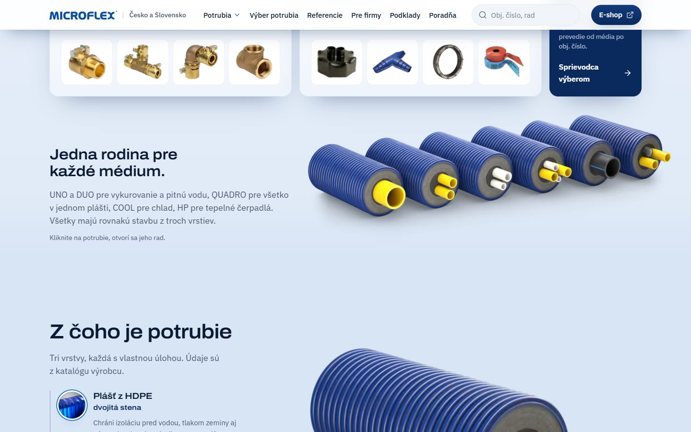

# Rodina na domove (21. 9. až 6. 11. 2026)



Sekcia „Jedna rodina pre každé médium.“ hneď pod katalógom. Render rodiny zo 6 rúr (od 26. 10. z vlastného 3D
modelu) prechádzal cez spodný okraj pásu katalógu a dobiehal do pravého okraja obrazovky. Vedľa bola veta
o systémoch a od 28. 10. sa dalo kliknúť alebo ťuknúť na potrubie a otvoril sa jeho rad (`RodinaVyber`).
Na telefóne bola v obrázku: [rodina-telefon.jpg](rodina-telefon.jpg).

**Prečo preč:** audit domova 6. 11. 2026 (`docs/AUDIT-DOMOV-2026-11-06.md`). Katalóg G2 od 5. 11. ukazuje všetky
systémy s rendermi a radmi, rodina to hneď pod ním opakovala obrázkom aj vetou. Myšlienka „všetky majú rovnakú
stavbu z troch vrstiev“ prešla do úvodu rozloženého rezu (`home.stavbaDomov`). Juraj odsúhlasil 6. 11.

**Súbory:** `RodinaDomov.astro` je sekcia ako samostatný komponent: označenie, dáta a štýly presne z
`web/src/templates/Domov.astro` (commit `43fdc71`, posledný stav s rodinou).

**Obnovenie:**
1. Skopírovať `RodinaDomov.astro` do `web/src/components/` a v `Domov.astro` vložiť `<RodinaDomov lang={lang} />`
   hneď za `<Katalog lang={lang} />`.
2. Do `web/src/i18n/ui.ts` do `home` vrátiť texty:

```ts
// sk
// Na obraze je šesť rúr (DUO na vykurovanie aj sanitu), preto nadpis bez počtu.
rodinaH2: 'Jedna rodina pre každé médium.',
// COOL má nosnú rúru PE 100, nie PE-Xa (katalóg s. 16 až 18). Spoločná je stavba, nie materiál rúry.
rodinaP: 'UNO a DUO pre vykurovanie a pitnú vodu, QUADRO pre všetko v jednom plášti, COOL pre chlad, HP pre tepelné čerpadlá. Všetky majú rovnakú stavbu z troch vrstiev.',
rodinaAlt: 'Rodina potrubí Microflex vedľa seba: UNO, DUO na vykurovanie aj sanitu, QUADRO, COOL a HP',
// cs
rodinaH2: 'Jedna rodina pro každé médium.',
rodinaP: 'UNO a DUO pro vytápění a pitnou vodu, QUADRO pro všechno v jednom plášti, COOL pro chlad, HP pro tepelná čerpadla. Všechny mají stejnou stavbu ze tří vrstev.',
rodinaAlt: 'Rodina potrubí Microflex vedle sebe: UNO, DUO pro vytápění i sanitu, QUADRO, COOL a HP',
```

3. V `web/src/components/Katalog.astro` vrátiť spodný okraj pásu na 200 px (tablet 140 px, telefón 100 px)
   a prechod pásu `--zem-1 → --zem-2`. Render rodiny ním prechádza, rodina pokračuje `--zem-2 → --zem-3`.

`RodinaVyber.astro`, `rodinaNaTuknutie` (`lib/novinky.ts`) a texty `novinky.rodina` ostali na webe, lebo ich
používa stránka Potrubia.
