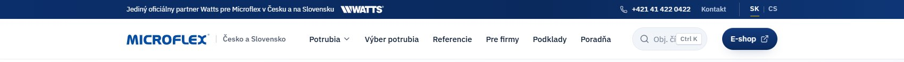

# Horný pás nad hlavičkou (4. 11. až 6. 11. 2026)

Tmavomodrý pás 36 px nad hlavičkou: vľavo „Jediný oficiálny partner Watts pre Microflex v Česku a na Slovensku“
s bielym logom Watts (odkaz na Kontakt), vpravo telefón, odkaz Kontakt a prepínač SK | CS. Nebol prilepený,
odroloval a lepkavá hlavička pod ním ostala. Na telefóne krátko „Jediný partner pre CZ a SK“, ikona telefónu
a jazyk: [horny-pas-telefon.jpg](horny-pas-telefon.jpg). Pod pásom je na snímkach aj stará hlavička s menu
v jednom riadku a krátkym poľom hľadania.

**Prečo preč:** Juraj 6. 11. 2026 vybral hlavičku A („ako e-shop“): hľadanie v strede prvého riadku, menu,
Kontakt a partnerstvo v druhom riadku. Telefón a jazyk prešli do prvého riadku hlavičky, Kontakt do menu,
partnerstvo do druhého riadku (krátka veta „Jediný oficiálny partner pre Česko a Slovensko“ vedľa loga Watts).
Pás by tak už len opakoval to isté a vzal 36 px z prvej obrazovky. Dôvod zmeny hlavičky: pole hľadania malo
nad 1 500 px šírky len 141 px a text „Obj. číslo, rad“ sa doň nezmestil (snímky návrhov
`snimky-stranok/navrh-hlavicka-uvod/`).

**Súbory:** `HornyPas.astro` je pás ako samostatný komponent: označenie a štýly presne z
`web/src/components/Hlavicka.astro` (commit `f3327ba`, posledný stav s pásom).

**Obnovenie:**
1. Skopírovať `HornyPas.astro` do `web/src/components/` a v `Hlavicka.astro` vložiť
   `<HornyPas lang={lang} alternates={alternates} aktivna={aktivna} />` pred `<header class="hdr" …>`
   (import `import HornyPas from './HornyPas.astro';`).
2. Do `web/src/i18n/ui.ts` do `partner` (sk aj cs) vrátiť `pas: 'Partner, kontakt a jazyk'` (názov oblasti
   pre čítačky).
3. V `web/src/styles/global.css` do zoznamu väčších dotykových plôch (`:where(… .langs a, .brand, …)`, dve
   pravidlá) vrátiť `.partner, .topbar-kontakt a`.
4. V `web/src/templates/Rad.astro` v pravidle pre tlač (`@media print`) vrátiť `:global(.topbar)` medzi
   skryté časti.
5. Z hlavičky A potom odobrať to, čo by sa opakovalo: telefón a jazyk v prvom riadku (`.hdr-tel`, `.langs`),
   partnerstvo v druhom riadku (`.partner`), prípadne Kontakt v menu.
