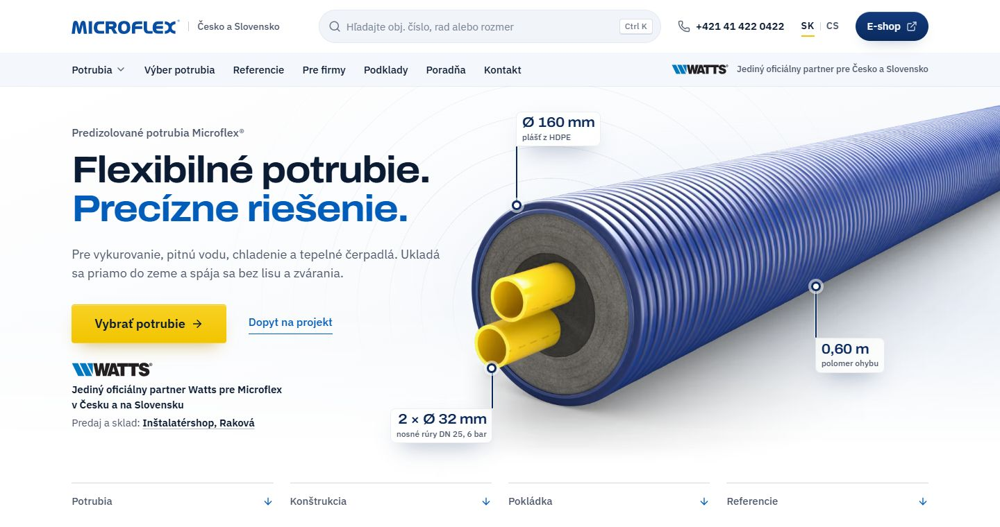

# Pôvodný úvod domova (22. 9. až 6. 11. 2026)



Svetlé pole, vľavo text, vpravo render DUO s kótami (Ø 160 mm, 2 × Ø 32 mm, 0,60 m), ktorý zasahoval až
pod text. Vľavo zhora: tichý riadok „Predizolované potrubia Microflex®“, dvojriadkový nadpis (druhý riadok
modrý), veta, žlté tlačidlo Vybrať potrubie a odkaz Dopyt na projekt, pod nimi logo Watts s vetou
„Jediný oficiálny partner Watts pre Microflex v Česku a na Slovensku“ a riadok o predaji. Pod úvodom
štyri skratky (Potrubia, Konštrukcia, Pokládka, Referencie) so šípkou nadol. Na telefóne:
[uvod-telefon.jpg](uvod-telefon.jpg). Snímky sú z obnoveného komponentu so súčasnou hlavičkou A,
stav aj so starou hlavičkou je v `archiv/navrhy-hlavicky-a-uvodu-2026-11-06/obrazky/1-kolo-0-dnes-*.jpg`.

**Prečo preč:** Juraj 6. 11. 2026: ľavá strana úvodu je „slabá, veľmi chaotická a zle rozložená, je tam veľa
informácií, rôzne písma, veľkosti, rozloženia“, potom „úvod chcem inak, zmeň kľudne aj grafiku aj dizajn“.
Z troch kôl návrhov (`archiv/navrhy-hlavicky-a-uvodu-2026-11-06/`) vybral K3 Materiál vo výklade A: tmavý
pás z plášťa s ohnutým predelom, rúra predel neprekročí. Partnerstvo Watts je od hlavičky A v jej druhom
riadku, skratky vypadli, lebo katalóg je hneď pod úvodom.

**Súbory:** `UvodDomov.astro` je celý pôvodný úvod ako samostatný komponent: dáta (render, kóty z dát
variantu, maska odlesku, skratky), označenie a štýly presne z `web/src/templates/Domov.astro`
(commit `cf27343`). Overené 6. 11. 2026: skopírovaný do `web/src/components/` sa zostaví a vyzerá ako
na snímke.

**Obnovenie:**
1. Skopírovať `UvodDomov.astro` do `web/src/components/`. V `web/src/templates/Domov.astro` nahradiť celú
   `<section class="hero" …>…</section>` riadkom `<UvodDomov lang={lang} />` (import
   `import UvodDomov from '../components/UvodDomov.astro';`) a zmazať štýly úvodu K3-A (od
   „Hero (úvod K3-A“ po „Ukážky pri rolovaní“ a riadky `.hero…` v blokoch do 1 100, 900 a 760 px),
   ako aj frontmatter `plastMakro`/`plastPas` a dáta úvodu, ktoré si komponent ráta sám.
2. Do `web/src/i18n/ui.ts` do `home` vrátiť texty skratiek:

```ts
// sk
skratky: { label: 'Rýchle odkazy na domovskej stránke', potrubia: 'Potrubia', konstrukcia: 'Konštrukcia', pokladka: 'Pokládka', projekty: 'Referencie' },
// cs
skratky: { label: 'Rychlé odkazy na domovské stránce', potrubia: 'Potrubí', konstrukcia: 'Konstrukce', pokladka: 'Pokládka', projekty: 'Reference' },
```

3. V `web/src/components/Katalog.astro` zmazať pravidlo `@media (min-width: 901px) { .katalog { padding-top: … + 116px } }`
   (väčší okraj je len pre štítok rúr úvodu K3-A, ktorý visí pod spodok úvodu).
