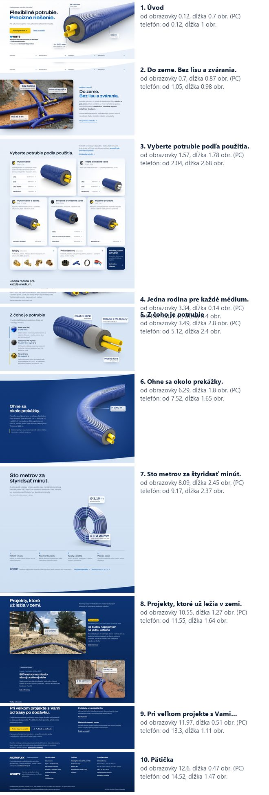
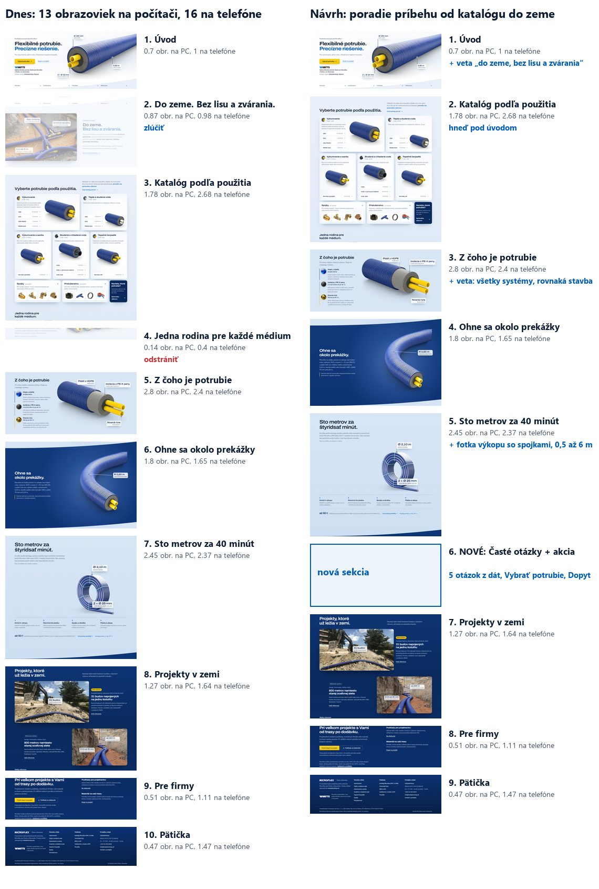

# Audit domovskej stránky 6. 11. 2026: poradie sekcií

Zadanie (Juraj): „Zamysli sa nad tým, ako sú postupne tie sekcie v domove, nemali by byť inak? Mne to úplne
nedáva taký zmysluplný flow, prípadne čo odstránim alebo pridáme.“

Audit hodnotí poradie a úlohu sekcií, nie vzhľad jednotlivých sekcií. Merané na webe zhodnom s nasadeným
(commit 616bfe4) v Chrome pri 1 440 × 900 a 390 × 844 px. Dĺžky sú v obrazovkách (výška okna), vrátane dráh
ukážok pri rolovaní. Pri každom zistení je oddelený fakt (zmerané alebo prečítané v kóde) a prečo to vadí.

Hodnotím podľa úlohy webu z `DESIGN.md` kap. 1 (do piatich sekúnd pochopiť, čo je Microflex, do troch klikov
nájsť rad a dimenziu a kúpiť) a troch publík (inštalatér, majiteľ domu, firma alebo projektant). Platné
rozhodnutia ostávajú: hadovito, zostup pod zem, 3D ukážky pri rolovaní, žiadne čísla kapitol.

## 1. Domov dnes

| # | Sekcia | Úloha | Počítač | Telefón |
|---|---|---|---|---|
| 1 | Úvod „Flexibilné potrubie. Precízne riešenie.“ | čo to je, Vybrať potrubie, Dopyt na projekt, partner Watts | 0,7 | 1,0 |
| 2 | Do zeme. Bez lisu a zvárania. | výhoda pri montáži, fotka výkopu so spojkami | 0,9 | 1,0 |
| 3 | Vyberte potrubie podľa použitia. | sortiment, odkazy na 12 radov, spojky, sprievodca | 1,8 | 2,7 |
| 4 | Jedna rodina pre každé médium. | všetky systémy v jednom obrázku | 0,1 | 0,4 |
| 5 | Z čoho je potrubie | rozložený rez, tri vrstvy | 2,8 | 2,4 |
| 6 | Ohne sa okolo prekážky. | ohyb, tmavá scéna | 1,8 | 1,7 |
| 7 | Sto metrov za štyridsať minút. | kotúč a kroky pokládky, až 60 t | 2,5 | 2,4 |
| 8 | Projekty, ktoré už ležia v zemi. | Považská Bystrica, Orange | 1,3 | 1,6 |
| 9 | Pri veľkom projekte s Vami… | Pre firmy, dopyt, podklady, istota výrobcu | 0,5 | 1,1 |
| | Pätička | | 0,5 | 1,5 |
| | **Spolu** | | **13,1** | **16,0** |

Rodina je nízka, lebo text aj obrázok sú zápornými okrajmi vytiahnuté do spodku katalógu. Na stránke je
celá a viditeľná.

## 2. Zistenia

**Z1. Príbeh skáče medzi „prečo“ a „čo“.**
Fakt: poradie je výhoda (2), sortiment (3, 4), stavba (5), výhoda (6), výhoda (7). Odkaz „Ako prebieha
pokládka“ v sekcii 2 vedie na sekciu 7, teda o šesť obrazoviek nižšie.
Prečo to vadí: Do zeme je kapitola pokládky. Stojí oddelene pred katalógom, takže čitateľ dostane polovicu
príbehu o montáži, potom sortiment a stavbu, a druhú polovicu až po dvoch ukážkach.

**Z2. To isté sa hovorí dvakrát až trikrát.**
Fakt:
- Sortiment je dvakrát za sebou. Katalóg ukáže päť použití s rendermi a všetkými radmi, hneď pod ním rodina
  ukáže tie isté systémy v jednom obrázku a veta ich znova vymenuje („UNO a DUO pre vykurovanie a pitnú vodu,
  QUADRO…, COOL…, HP…“).
- Tri vrstvy sú dvakrát: rodina („rovnakú stavbu z troch vrstiev“) a hneď nato rez („Tri vrstvy, každá
  s vlastnou úlohou“).
- „Bez zvárania, bez kolien, bez špeciálneho náradia“ je trikrát: Do zeme, Ohyb aj Pokládka.

Prečo to vadí: opakovanie nepôsobí ako dôraz, ale ako vata. Rodina mala zmysel pri starom katalógu so
záložkami, ktorý ukazoval len jedno použitie. Od G2 (5. 11.) ukazuje katalóg všetky systémy sám.

**Z3. Stránka je dlhá a v strede má tunel ukážok.**
Fakt: na počítači má 13,1 obrazovky, na telefóne 16. Tri ukážky pri rolovaní za sebou (rez, ohyb a kotúč)
zaberú 7,0 z 13,1 obrazovky na počítači a 6,4 zo 16 na telefóne.
Prečo to vadí: ukážky sú najsilnejší obsah webu, ale za sebou bez prestávky a bez ďalšieho kroku na konci.
Kto ich dopozerá, nemá kam kliknúť.

**Z4. Po presviedčaní nie je ďalší krok.**
Fakt: tlačidlo „Vybrať potrubie“ je na obrazovke 0,5. Ďalšie tlačidlo, „Poslať dopyt na projekt“, je až na
obrazovke 12,2 (počítač) alebo 13,6 (telefón). Medzi nimi sú len textové odkazy.
Prečo to vadí: rozhodnutie 28. 10. hovorí, že hlavná cesta je výber potrubia a výrazná druhá je dopyt na
projekt. Ani jedna sa neponúkne v mieste, kde je čitateľ najpresvedčenejší, teda po pokládke.

**Z5. Katalóg je zbytočne nízko.**
Fakt: katalóg začína na obrazovke 1,6 (počítač) a 2,0 (telefón), lebo nad ním je pás Do zeme.
Prečo to vadí: inštalatér, ktorý vie, čo chce, musí najprv prejsť výhodou montáže. Úloha „do troch klikov
nájsť rad“ sa predĺži o celú obrazovku.

**Z6. Dôkazy sú až na konci.**
Fakt: projekty začínajú na obrazovke 10,6 (počítač) alebo 11,6 (telefón). Istota výrobcu (od roku 1994,
ISO 9001, certifikáty v ôsmich krajinách) je posledná veta sekcie Pre firmy.
Prečo to vadí: menej. Projekty patria do tmavého podzemia spolu s Pre firmy a pätičkou (zostup pod zem),
preto ich vyššie nepresúvam. Partner Watts je v úvode, čo prvú dôveru drží.

## 3. Návrh poradia (odporúčam)

Príbeh ide s výrobkom od katalógu až do zeme: **čo to je → čo máme → z čoho je → čo vie → ako sa kladie →
otázky a ďalší krok → kde už leží → pre firmy.** Zostup pod zem ostáva: svetlý úvod a katalóg, tmavý ohyb,
svetlá pokládka, tmavé podzemie.

| # | Sekcia | Zmena |
|---|---|---|
| 1 | Úvod | Do vety pod nadpisom jedna myšlienka z Do zeme, napríklad: „Predizolované potrubie do zeme pre vykurovanie, pitnú vodu, chladenie a tepelné čerpadlá. Spája sa bez lisu a zvárania.“ Hneď je jasné, kam potrubie patrí, čo bol dôvod pásu Do zeme. |
| 2 | Katalóg | Hneď pod úvodom. Začne asi na obrazovke 0,7 na počítači a 1,0 na telefóne. |
| 3 | Z čoho je potrubie | Do úvodnej vety prevziať myšlienku rodiny: všetkých päť systémov má rovnakú stavbu z troch vrstiev. |
| 4 | Ohne sa okolo prekážky. | Bez zmeny. |
| 5 | Sto metrov za štyridsať minút. | Sem prejde fotka výkopu so svornými spojkami a kótami z Do zeme ako dôkaz kroku „Spojky a skúška“. Hĺbka 0,5 až 6 m bude pri zaťažení 60 t. „Bez zvárania“ len raz. |
| 6 | Nové: Časté otázky a akcia | Päť otázok, ktoré už sú napísané pri kategóriách v `content/faq.ts` (UNO alebo DUO, akú dimenziu, ako hlboko sa ukladá a ako sa spája, štandardná a zosilnená izolácia, kedy QUADRO), v SK aj CS. Otázka je riadok so šípkou, ktorý sa rozbalí. Na konci tlačidlá Vybrať potrubie a Dopyt na projekt. |
| 7 | Projekty | Bez zmeny. |
| 8 | Pre firmy | Bez zmeny. |

**Odstrániť z domova:** Rodinu (Z2). Ak sa ti obrázok rodiny páči, môže ísť na stránku Potrubia.
**Zlúčiť:** Do zeme ako samostatný pás. Správa ide do úvodu, fotka do pokládky.

Očakávaný účinok (odhad z meraní): z domova zmiznú dve sekcie a pribudne jedna krátka, fotka výkopu
v pokládke ju trochu predĺži. Dĺžka sa preto zmení málo, asi na 12,5 až 13 obrazoviek na počítači, lebo
väčšinu stránky tvoria ukážky. Zisk je v poradí: každú vec povie raz a na mieste, kam patrí, katalóg je
o celú obrazovku vyššie a po ukážkach je ďalší krok. Skratky v úvode (Potrubia, Konštrukcia, Pokládka,
Referencie) ostanú.

**Voliteľne, ak chceš kratšiu stránku:** skrátiť dráhy ukážok pri rolovaní (rez 2,8 → 2,0, ohyb 1,8 → 1,4,
kotúč 2,5 → 1,8 obrazovky). Ukážky ostanú pri rolovaní, len sa prehrajú na kratšom úseku. Stránka by mala
asi 11 obrazoviek na počítači. Odporúčam až po tom, čo si nové poradie prejdeš.

## 4. Čo by som nemenil

- **Poradie ukážok** (z čoho je → ako sa ohne → ako sa kladie): je logické a sedí so zostupom pod zem.
- **Projekty a Pre firmy na konci:** tvoria s pätičkou jedno tmavé podzemie.
- **Ďalšie ukážky ani pásy čísel nepridávať.** Stránka potrebuje menej opakovania, nie viac obsahu.

## 5. Rozhodnutia pre Juraja

1. **Rodina z domova preč?** 28. 10. si povedal, že ostáva. Vtedy ešte katalóg neukazoval všetky systémy.
2. **Do zeme zlúčiť?** Správa do úvodu, fotka do pokládky. 4. 11. si pás dal hneď pod úvod, aby bolo jasné,
   kam potrubie patrí; návrh to zachová vetou v úvode.
3. **Časté otázky na domov:** áno, alebo nie?
4. **Kratšie dráhy ukážok:** voliteľné, až neskôr.
